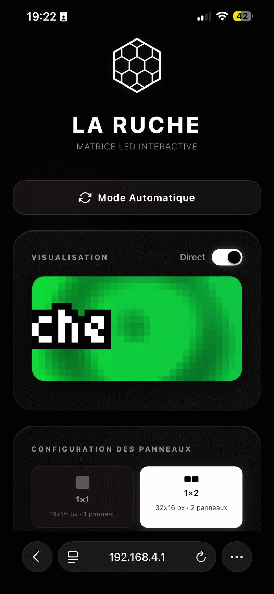
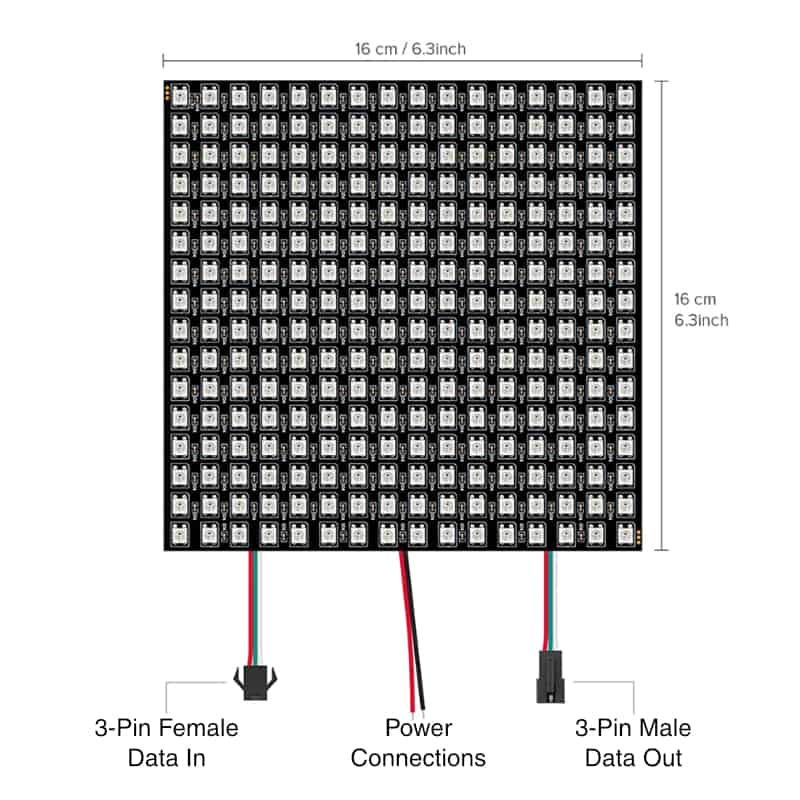
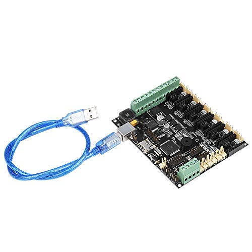
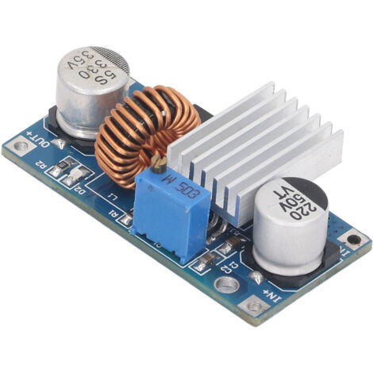
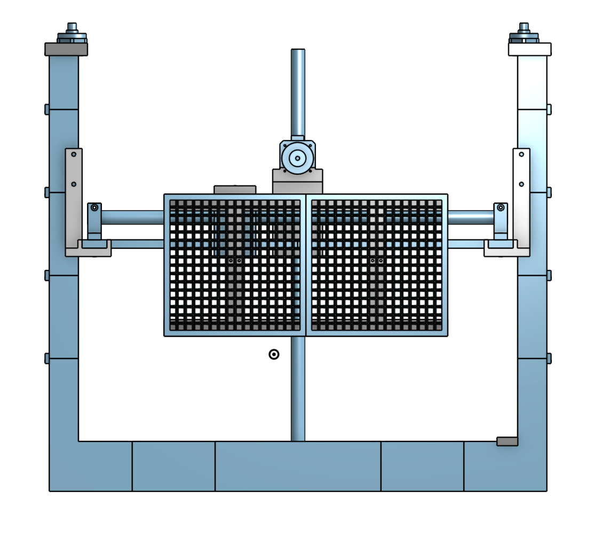
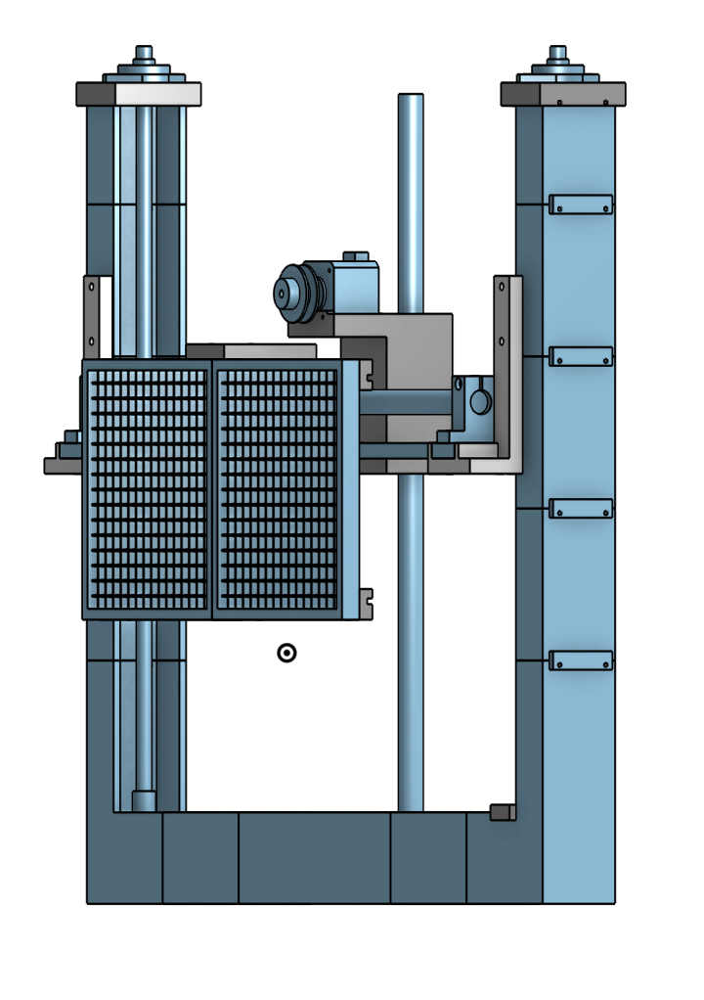
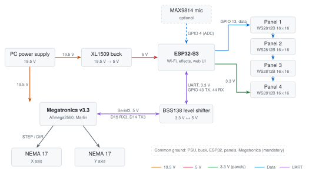
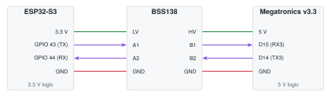
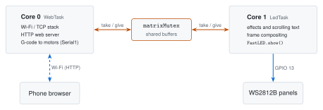

# La Ruche Matrix

**Wi-Fi controlled LED matrix panel for live events: ESP32-S3 + 1 024 WS2812B LEDs on a motorized 2-axis structure.**

Built by Matthieu POUPIN & Marceau GUIGUI - Option Culture Maker, Eirlab / ENSEIRB-MATMECA, 2026.

<p align="center">
  
</p>

---

## Overview

La Ruche Matrix is an LED panel for music events. People in the audience connect from their phone and can send scrolling text, draw pixel by pixel or pick one of 31 animations. Everything updates in real time, and no app is needed.

- 1 024 RGB LEDs on four chained WS2812B 16×16 panels
- Wi-Fi control: the panel is its own access point, and the interface opens in any browser
- 31 animations, including Matrix rain, Pac-Man, Game of Life, Pong, a 3D cube and an audio visualizer
- A motorized 2-axis structure that moves the panel without taking it down
- Budget: about 150 to 160 €

---

## Demo

<p align="center">
  
</p>

---

## Hardware

### Electronics

| Component | Qty | Notes |
|-----------|-----|-------|
| ESP32-S3-N16R8 | 1 | Main controller: Wi-Fi, native USB, 16 MB flash |
| WS2812B 16×16 LED panels | 4 | Individually addressable, chained in series |
| Megatronics v3.3 | 1 | Salvaged, runs Marlin, controls motors via ATmega2560 |
| 19.5 V PSU (modified PC adapter) | 1 | Salvaged |
| XL1509 buck converter | 1 | 19.5 V → 5 V, powers ESP32 |
| BSS138 4-channel level shifter | 1 | 3.3 V ↔ 5 V between ESP32 and Megatronics |
| MAX9814 microphone | 1 | Optional, for audio-reactive animations |
| Wires, connectors, perfboard | | |

<p align="center">
  
  <br><em>WS2812B 16×16 panel: Data In, Power, Data Out</em>
</p>

<p align="center">
  
  <br><em>Megatronics v3.3: runs Marlin, controls the stepper motors</em>
</p>

<p align="center">
  
  <br><em>XL1509 adjustable buck converter: 19.5 V → 5 V</em>
</p>

### Mechanical

The structure works like a Cartesian 3D printer: two independent axes move the panel while it stays mounted on the lighting truss.

| Component | Qty | Unit price |
|-----------|-----|-----------|
| SH16/SK16 shaft supports | 4 | 6.11 € |
| SH8/SK8 shaft supports | 4 | 4.26 € |
| SC16UU linear bearings (∅16 mm) | 4 | 15.27 € |
| SC8UU linear bearings (∅8 mm) | 2 | 4.95 € |
| ∅16 mm h6 precision shaft (500 mm) | 2 | 9.64 € |
| ∅8 mm h6 precision shaft (500 mm) | 2 | 5.91 € |
| TR10×4P2 trapezoidal leadscrew (500 mm) | 2 | 5.85 € |
| TR10×4P2 bronze/alu leadscrew nut | 2 | 31.63 € |
| D20L25 flexible coupling (5/10 mm) | 2 | 6.60 € |
| GT2 open belt 6 mm (~1 000 mm) | 4 | 7.15 € |
| GT2 20-tooth pulley (5 mm bore) | 2 | 2.27 € |
| NEMA 17 stepper motors (42SH0034D) | 2 | Salvaged (~10 € each otherwise) |
| PLA printed parts | | STL files in this repo |
| Aluminium profiles + hardware | | Frame reinforcement |

**Y axis (vertical):** a NEMA 17 turns a TR10×4P2 trapezoidal leadscrew, and a belt drives a second screw so both sides move together. The bronze nut fixed to the carriage moves up or down as the screws turn. The motion is slow but precise, and the screw is self-locking, so the panel holds its position with the motor unpowered.

**X axis (horizontal):** the second motor pulls a carriage along 16 mm precision shafts with a GT2 belt.

<p align="center">
  
  <br><em>Front view: 3D CAD of the mechanical structure</em>
</p>

<p align="center">
  
  <br><em>Side view</em>
</p>

### Tools required

- 3D printer (PLA)
- Soldering iron
- Multimeter
- VSCode + PlatformIO extension

---

## Wiring

The 19.5 V supply feeds the XL1509 buck converter, which outputs 5 V to the ESP32-S3's `5V IN` pin. The ESP regulates this down to 3.3 V, and the four WS2812B panels run from that 3.3 V rail. They tolerate this voltage in practice, and FastLED limits the total current to 500 mA. The motors take 19.5 V directly through the Megatronics.

The panels are chained in series, so a single data wire from GPIO 13 goes through all four in order. The ESP, the panels and the Megatronics must share a common ground. Without it, the data signal is not read reliably.

<p align="center">
  <picture>
    <source media="(prefers-color-scheme: dark)" srcset="assets/wiring-diagram-dark.svg">
    
  </picture>
  <br><em>Simplified wiring diagram</em>
</p>

The ESP32-S3 uses 3.3 V logic and the ATmega2560 uses 5 V, so the UART link goes through a BSS138 level shifter.

<p align="center">
  <picture>
    <source media="(prefers-color-scheme: dark)" srcset="assets/level-shifter-dark.svg">
    
  </picture>
</p>

---

## Firmware

### Quickstart (5 minutes)

1. Install [VSCode](https://code.visualstudio.com/) + the **PlatformIO** extension
2. Clone the repo: `git clone https://github.com/matthieupoupin3704-alt/la-ruche-matrix`
3. Open the folder in VSCode
4. Plug in the ESP32-S3 via USB-C (N16R8 recommended for RAM)
5. In PlatformIO: click **Upload** (`esp32dev` environment)

PlatformIO then downloads the libraries, compiles and flashes the board.

### Code structure

| File | Role |
|------|------|
| `src/main.cpp` | Web server, scrolling text, settings persistence, dual-core task management |
| `include/effects.h` | 31 animations, each effect is an independent function |

### Dual-core architecture

The web server runs on core 0, next to the Wi-Fi stack, and the LED rendering runs on core 1. A mutex protects the buffers shared by both tasks; without it, the display shows random corruption.

<p align="center">
  <picture>
    <source media="(prefers-color-scheme: dark)" srcset="assets/firmware-dual-core-dark.svg">
    
  </picture>
  <br><em>Dual-core task architecture</em>
</p>

### Image pipeline

<p align="center">
  <picture>
    <source media="(prefers-color-scheme: dark)" srcset="assets/firmware-pipeline-dark.svg">
    
  </picture>
  <br><em>Effect → Topology mapping → Physical output</em>
</p>

### Topologies

The topology can be changed from the web interface without recompiling. The resolution (`matW`, `matH`) and the number of active LEDs are global variables recomputed on the fly, and the choice is saved in the ESP's flash.

| Topology | Resolution | Panels |
|----------|-----------|--------|
| 1×1 | 16×16 px | 1 |
| 1×2 | 32×16 px | 2 side by side |
| 1×4 | 64×16 px | 4 in a strip |
| 2×2 | 32×32 px | 4 in a square |

### Motor control

The Megatronics v3.3 runs Marlin on its ATmega2560. The ESP32 sends G-code from its Serial1 to Marlin's Serial3 at 115200 baud, and Marlin takes care of acceleration. Moves are absolute and clamped to software endstops:

```cpp
x = constrain(x, 0.0f, MOTOR_X_MAX);
y = constrain(y, 0.0f, MOTOR_Y_MAX);
snprintf(buf, sizeof(buf), "G1 X%.1f Y%.1f F%d", x, y, feedrate);
motorSend(buf);
```

The emergency stop button sends `M410`.

In `marlin_config/Configuration.h`:

```cpp
#define SERIAL_PORT 3      // Serial3 (NXT connector, D14/D15) → ESP32
#define BAUDRATE 115200
```

> **Note:** the vertical motor is plugged into the Z slot of the Megatronics, because the Y driver on this salvaged board was faulty.

---

## Usage

### Connecting

1. Power on the panel
2. On your phone: Wi-Fi → connect to **La-Ruche-Matrix**
3. Open a browser and go to `192.168.4.1`

The interface works in any mobile browser.

### What you can do

- Scrolling text: type a message, pick one of 7 fonts (from tiny pixel fonts to a large sans-serif) and send it. The text takes the selected hue.
- Drawing: a touch canvas to draw pixel by pixel, with a pencil, an eraser and a button that draws the La Ruche logo.
- Animations: the 31 effects (Matrix rain, Doom corridor, Pac-Man, Game of Life, Pong, rotating 3D cube, audio visualizer...) follow the hue, speed and brightness settings. Some react to sound when the MAX9814 microphone is enabled (`MIC_ENABLED` in `main.cpp`).
- Movement: an on-screen D-pad moves the panel, with an emergency stop button.
- Auto mode: the panel switches animation and font every 15 seconds.
- Live preview: displays in the browser what the panel shows, useful for technicians standing behind it.

---

## Adding your own animations

In `include/effects.h`, all animations follow the same pattern:

```cpp
void myEffect() {
    for (uint8_t y = 0; y < MATRIX_H; y++)
        for (uint8_t x = 0; x < MATRIX_W; x++)
            _px(x, y) = CHSV(COULEUR_HUE + x * 4, 255, 200);
}
```

- `_px(x, y)` writes a pixel in logical coordinates
- `COULEUR_HUE` is the hue chosen by the user
- `MATRIX_W` / `MATRIX_H` adapt automatically to the active topology

Then add the function to `_table[]`, its name to `_names[]`, and increment `COUNT`. The web interface lists it automatically.

---

## Known limitations

- Y axis: one of the vertical shafts has a rough spot that now blocks the movement.
- X axis: the GT2 belt was hard to tension correctly. A leadscrew would have been a better choice.

---

## Acknowledgements

Thanks to [Eirlab](https://www.eirlab.net/) for the workspace, the equipment we borrowed and the parts it bought for the project, and to Julien Allali, Antonio Berejano and Adrien Boussicault for their guidance.

---

## License

The code and CAD files are in this repository.

---

*Matthieu POUPIN & Marceau GUIGUI - ENSEIRB-MATMECA, Eirlab, 2026*  
*Full build log: [eirlab.net](https://www.eirlab.net/2026/04/20/lumiere-scenique/)*
